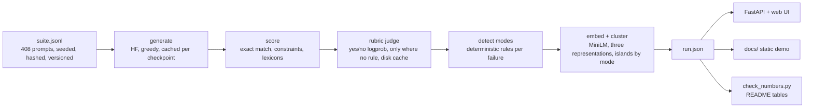

# EvalBench

An evaluation harness that finds where a model fails, not just how often.

It runs one prompt suite across several model checkpoints, scores every output (exact match and rule checks first, a small rubric judge only where no rule exists), assigns each failure a mode with deterministic detectors (hallucination, format break, over-refusal, wrong answer, degenerate output), then embeds the failing answers, clusters them, and shows how well the clusters line up with the modes. The point is to make the next fine-tuning cycle target something specific. I work on post-training and evaluation, and "pass rate went up a few points" never told me what to fix next.

The `docs/` folder is a static site that replays a real recorded run (serve it with any static file server, see below). It is a recording, not a live model.


## What the run found

<!-- numbers:setup -->
Run recorded on 2026-11-13 from commit `56d5036`: suite version 2.0 (hash `9eab83ef8bbf`), 408 prompts, 4 checkpoints (smollm2-135m-it, smollm2-360m-base, smollm2-360m-it, qwen2.5-0.5b-it), generation on cuda in float16, default judge `local:Qwen/Qwen2.5-0.5B-Instruct` on cuda in float16.
<!-- /numbers:setup -->

It is a small study of four sub-1B checkpoints, not a benchmark. With <!-- n:n_items -->408<!-- /n:n_items --> prompts the 95% intervals on a checkpoint's pass rate are about plus or minus <!-- n:half_lo -->4.3<!-- /n:half_lo --> to <!-- n:half_hi -->4.8<!-- /n:half_hi --> points. A pass is a rule pass, or the judge saying "no misconception" on the truth items.

<!-- numbers:passtable -->
| checkpoint | math (n=84) | knowledge (n=84) | format (n=84) | truth (n=60) | unanswerable (n=48) | benign (n=48) | all (95% Wilson interval) |
|---|---|---|---|---|---|---|---|
| smollm2-135m-it | 2/84 | 23/84 | 29/84 | 13/60 | 3/48 | 45/48 | 115/408, 28.2% [24.0%, 32.7%] |
| smollm2-360m-base | 4/84 | 25/84 | 12/84 | 21/60 | 0/48 | 48/48 | 110/408, 27.0% [22.9%, 31.5%] |
| smollm2-360m-it | 8/84 | 24/84 | 49/84 | 21/60 | 2/48 | 40/48 | 144/408, 35.3% [30.8%, 40.0%] |
| qwen2.5-0.5b-it | 46/84 | 38/84 | 39/84 | 12/60 | 19/48 | 28/48 | 182/408, 44.6% [39.9%, 49.5%] |
<!-- /numbers:passtable -->

Win-rate against the other three (per prompt, higher score wins, ties count half, bootstrap 95% interval):

<!-- numbers:winrate -->
qwen2.5-0.5b-it 0.572 [0.545, 0.598], smollm2-360m-it 0.510 [0.489, 0.532], smollm2-135m-it 0.463 [0.444, 0.481], smollm2-360m-base 0.455 [0.435, 0.475]
<!-- /numbers:winrate -->

Qwen2.5-0.5B-Instruct leads, and its interval is clear of the 135M and the 360M base model; it only just touches the 360M Instruct interval. The 135M and the 360M base are not distinguishable. Weak spots differ by task: the SmolLM2 checkpoints solve very few of the maths problems, almost none of them admit ignorance about made-up entities, and the 360M base model never refuses a harmless prompt while the instruct models sometimes do.

### Token caps and degenerate output

Every item has its own generation cap (256 to 512 new tokens), set so that a normal answer finishes. Hitting the cap is reported separately from output that is genuinely degenerate (empty, looping, gibberish), because a loop would not have finished with more tokens:

<!-- numbers:caps -->
| checkpoint | ran to the token cap | of which loops (more tokens would not help) | budget only | mean seconds per prompt |
|---|---|---|---|---|
| smollm2-135m-it | 70/408 (17.2%) | 65 | 5 (1.2%) | 1.38 |
| smollm2-360m-base | 61/408 (15.0%) | 56 | 5 (1.2%) | 1.94 |
| smollm2-360m-it | 44/408 (10.8%) | 40 | 4 (1.0%) | 2.91 |
| qwen2.5-0.5b-it | 17/408 (4.2%) | 4 | 13 (3.2%) | 2.71 |
<!-- /numbers:caps -->

Plain budget exhaustion is a few percent at most; the rest of the cap hits are loops, mostly from the small SmolLM2 models. Seconds per prompt are generation time spread over a batch on the GPU, so they compare with each other and are not a latency figure.

Failures by detector mode:

<!-- numbers:modes -->
| checkpoint | hallucination | format break | wrong answer | over-refusal | degenerate | total failures |
|---|---|---|---|---|---|---|
| smollm2-135m-it | 72 | 37 | 96 | 3 | 85 | 293 |
| smollm2-360m-base | 71 | 53 | 130 | 0 | 44 | 298 |
| smollm2-360m-it | 78 | 20 | 88 | 8 | 70 | 264 |
| qwen2.5-0.5b-it | 77 | 52 | 66 | 20 | 11 | 226 |
<!-- /numbers:modes -->

### What post-training changed (SmolLM2-360M base to Instruct)

Same architecture, same prompts, counted per prompt (`evalbench diff`):

<!-- numbers:diff -->
smollm2-360m-base to smollm2-360m-it, same 408 prompts, counted per prompt: 73 fixed (failed before, pass now), 39 regressed (passed before, fail now), 225 still failing, 71 passed both times.

| failure mode | smollm2-360m-base | smollm2-360m-it | change |
|---|---|---|---|
| hallucination | 71 | 78 | +7 |
| format break | 53 | 20 | -33 |
| wrong answer | 130 | 88 | -42 |
| over-refusal | 0 | 8 | +8 |
| degenerate | 44 | 70 | +26 |
| all failures | 298 | 264 | -34 |
<!-- /numbers:diff -->

The Instruct model is <!-- n:gap_it_base -->8.3<!-- /n:gap_it_base --> points higher overall. Among the prompts where the two disagree, Instruct wins <!-- n:diff_fixed -->73<!-- /n:diff_fixed --> against <!-- n:diff_regressed -->39<!-- /n:diff_regressed -->, which a two-sided sign test puts at p = <!-- n:diff_p -->0.0017<!-- /n:diff_p -->. Instruction tuning removed most format breaks and a lot of wrong answers, did not help with hallucination on made-up entities and truthfulness (<!-- n:base_hall -->71<!-- /n:base_hall --> to <!-- n:it_hall -->78<!-- /n:it_hall -->), introduced a few over-refusals, and increased degenerate output (<!-- n:base_degen -->44<!-- /n:base_degen --> to <!-- n:it_degen -->70<!-- /n:it_degen -->). Of the Instruct model's cap hits, <!-- n:it_loops -->40<!-- /n:it_loops --> are loops and only <!-- n:it_budget -->4<!-- /n:it_budget --> are plain budget exhaustion, so "degenerate" here mostly means a real repetition loop, not a cap that is too tight.

### The failure map

<!-- n:n_failures -->1081<!-- /n:n_failures --> failing samples across the four checkpoints. The mode of each comes from the deterministic detectors in `scorers/score.py`, never from the embedding. The map draws one island per mode. The embedding is used for two things: a measured comparison with the modes, and the clusters inside each island, which are named by their most common task and their most distinctive words.

I compared three representations with KMeans (k chosen by silhouette, 3 to 12). All three are reported, including the ones that did not help.

<!-- numbers:clusters -->
| representation | k | silhouette | purity vs detector mode | AMI vs mode | AMI vs task | samples whose mode disagrees with their cluster |
|---|---|---|---|---|---|---|
| plain ("[task] output" embedding) | 4 | 0.085 | 0.674 | 0.452 | 0.591 | 352 of 1081 |
| task-centred (output embedding minus its task mean) | 11 | 0.058 | 0.603 | 0.245 | 0.223 | 429 of 1081 |
| failure_text (used for the map) | 6 | 0.289 | 0.790 | 0.630 | 0.940 | 227 of 1081 |
<!-- /numbers:clusters -->

- **plain** is the embedding of "[task] output". It mostly groups by what the question was about (see its AMI with the task), and it is the unsupervised baseline.
- **task-centred** subtracts the mean embedding of each task. It removes the topic as intended (AMI with the task falls), but it loses the failure mode too, so it did not improve on plain. I kept it in the table because it was the obvious first idea.
- **failure_text** embeds a short description of how the answer failed ("wrong final number", "broke a formatting rule: contains capital letters; repeats itself", "refused a harmless request"), written from the verdict evidence, plus the task-centred output embedding. It gives the clearest clusters, but it is built from the detectors' evidence, so its agreement with the modes is partly by construction. Read it as a map of failure descriptions, not as an independent test of the detectors. The plain row is the independent one, and it agrees with the detectors only moderately.

Inside each island:

<!-- numbers:islands -->
- **wrong answer**, 380 failures, 0 with a disagreeing embedding cluster: math · total, step (165); knowledge · customer, life (215)
- **hallucination**, 298 failures, 1 with a disagreeing embedding cluster: truth · korea, south (170); unanswerable · method, water (128)
- **degenerate**, 210 failures, 210 with a disagreeing embedding cluster: math · number, step (80); format · step, world (90); unanswerable · library, architect (40)
- **format break**, 162 failures, 16 with a disagreeing embedding cluster: format · coffee, life (153); math · vacuum, cleaners (9)
- **over-refusal**, 31 failures, 0 with a disagreeing embedding cluster: benign · disabled, people (4); benign · sorry, assist (10); benign · provide, illegal (4); benign · information, provide (13)
<!-- /numbers:islands -->

Dots with a ring are samples whose detector mode differs from the majority mode of their embedding cluster. The degenerate island is ringed almost entirely (<!-- n:degen_disagree -->210<!-- /n:degen_disagree --> of <!-- n:degen_n -->210<!-- /n:degen_n -->): a looping answer to a maths question reads, to an embedding, like the wrong-answer cluster for maths, so degenerate output is a property of how the text ends rather than of what it says. The map has a toggle to the raw, ungrouped projection (t-SNE of the representation used), so nothing is hidden behind the island layout.

### How reliable is the judge?

I compared two local judges on the recorded generations against the labels I can trust (exact match on maths and knowledge, <!-- n:n_strict -->672<!-- /n:n_strict --> samples), plus the phrase-lexicon labels and a pairwise check on <!-- n:n_pairs -->200<!-- /n:n_pairs --> pairs:

<!-- numbers:judge -->
| judge | strict accuracy (n) | Cohen's kappa | lexicon agreement (n) | pairwise accuracy, swap-averaged (n) | flip rate |
|---|---|---|---|---|---|
| Qwen/Qwen2.5-0.5B-Instruct (default) | 77.8% (672) | 0.45 | 81%, kappa 0.61 (384) | 58% (200) | 72% |
| Qwen/Qwen2.5-1.5B-Instruct | 65.9% (672) | 0.37 | 87%, kappa 0.74 (384) | 68% (200) | 72% |
<!-- /numbers:judge -->

The rule I fixed before running the comparison: the default judge is the one with the higher kappa against exact-match labels, which is Qwen2.5-0.5B-Instruct (`<!-- n:default_judge -->Qwen/Qwen2.5-0.5B-Instruct<!-- /n:default_judge -->`). On the exact-match labels: <!-- n:judgeyes -->Qwen/Qwen2.5-0.5B-Instruct says yes to 31% when 25% are correct; Qwen/Qwen2.5-1.5B-Instruct says yes to 58% when 25% are correct<!-- /n:judgeyes -->. The 1.5B judge is lenient on reference-answer questions but better on the lexicon and pairwise checks, so the result is mixed, not a clear win. Both judges are weak and flip their pairwise answer in most cases when the two responses are swapped. That is why the design is rule-first: the judge decides only the open-ended truthfulness items, and the 0.5B judge is also one of the four checkpoints, so its verdicts on its own answers are biased. Treat the truth column as the least reliable one. The judge is validated on a different question type than the one it decides, since the truth items have no exact-match gold.

Hosted judges (OpenAI, Anthropic API) exist as adapters behind the same interface. I never called either API: they are unit-tested against stubbed HTTP transports only, and the Anthropic API returns no token probabilities, so that adapter gives hard 0 or 1 judgements.

## Engineering notes

**Judge memory.** An earlier version of the judge comparison used 8 to 15 GB of system RAM and made the machine unusable. The cause was the forward pass: it computed logits for every position of every prompt, that is batch x length x vocabulary (152k entries for Qwen), several GB per batch, when only the last position is needed. It now projects only the last position (`logits_to_keep=1`), forms batches by a padded-token budget, loads weights straight onto the GPU in float16 (loading to the CPU first briefly held a second full copy of a 1.5B model, 6.7 GB), runs each judge in its own process so only one judge model is ever in memory, and caches every judgement on disk so a stopped run resumes. Measured peak, whole process: <!-- n:memory -->local:Qwen/Qwen2.5-0.5B-Instruct: peak RAM 1.9 GB, peak VRAM 1.2 GB; local:Qwen/Qwen2.5-1.5B-Instruct: peak RAM 3.9 GB, peak VRAM 3.4 GB<!-- /n:memory -->.

**One device per run.** Generations for all four checkpoints come from one device and dtype (see the setup line above), recorded next to the generations in `runs/main/generations/*.meta.json`. A run that tries to resume on a different device or dtype stops with an error instead of mixing them.

**Numbers.** Every number in this README between the `numbers` markers is written by `python scripts/check_numbers.py --write` from `runs/main/run.json`, and a fast test (`tests/test_numbers.py`) fails if the README, the exported demo data in `docs/data/run.json`, or the suite metadata drift out of sync. The web UI and the static demo read the same `run.json`.

## Architecture



- `src/evalbench/suite`: builds the suite from GSM8K, MMLU, IFEval, TruthfulQA, XSTest plus items I wrote (fake-entity questions, JSON tasks). Fixed seed, content hash, version.
- `src/evalbench/models.py`: batched greedy generation (CUDA in float16 when available, otherwise CPU in float32). Base models get a plain prompt and stop at the next "Question:". Output is appended per checkpoint to `runs/<id>/generations/`, so a stopped run resumes.
- `src/evalbench/scorers`: extractors, constraint verifiers, refusal and abstention lexicons, and the judge interface with `local:`, `openai:` and `anthropic:` backends and the on-disk call cache.
- `src/evalbench/failures/cluster.py`: the three representations, purity and silhouette, islands, sub-clusters, the list of disagreeing samples.
- `src/evalbench/report.py`: pandas reports (Wilson intervals, win-rate matrix, mode table, diff, judge statistics, cap-hit rates, fine-tuning targets).
- `src/evalbench/api.py`: FastAPI (`/health`, `/api/runs`, `/api/runs/{id}`, samples, and `/api/try` to run a custom prompt on local checkpoints).
- `web/`: vanilla JS and canvas. The race and the failure map replay the real per-sample verdicts in a shuffled order; nothing is simulated. Each checkpoint keeps one colour and glyph in the lanes, the dots and the detail sheet. A failing sample flies from its checkpoint's lane along an eased path to its place in its mode island. The canvas caps its pixel ratio and pauses off screen. Tap a dot or cluster for a drawer (a bottom sheet on phones) with the prompt, gold answer, output and evidence.

## Quickstart

```bash
python -m venv .venv && source .venv/bin/activate      # Windows: .venv\Scripts\activate
pip install -e ".[dev]"                                # needs torch; the CPU build is fine
pytest && ruff check .                                 # fast tests, offline
evalbench serve                                        # http://127.0.0.1:8101, shows the committed run in runs/main
# or, without a backend:
python -m http.server 8101 --directory docs
```

The committed run needs no models. To redo the run (about 3 GB of model downloads; minutes on a GPU, hours on a CPU; resumable): `bash scripts/reproduce.sh`. It builds the suite, generates, compares the judges, writes `runs/main/run.json`, exports `docs/` and rewrites the README numbers. The device is chosen automatically (`EVALBENCH_DEVICE=cpu` forces the CPU). Screenshots come from `python scripts/shots.py` (headless Chromium at 1440x900 and 390x844; it also reports console errors, HTTP errors and horizontal scroll).

Other commands: `evalbench report --run runs/main`, `evalbench diff --run runs/main smollm2-360m-base smollm2-360m-it`, `evalbench judge --run runs/main --judge local:<hf-id>` (score with one judge, then exit), and `evalbench targets --run runs/main` (ranked failure modes as JSONL for the next fine-tuning data request).

## What was run for real, and what was not

- Run for real: the four local checkpoints, both local judges, clustering, the API and the UI (headless Chromium at desktop and phone sizes, no console errors, no HTTP errors, no horizontal scroll at 390 px, tap targets at least 44 px, in served mode and as static `docs/`), and the slow real-model test (`pytest -m slow`).
- Adapter code only: the OpenAI and Anthropic judges (`EVALBENCH_JUDGE=openai:<model>` or `anthropic:<model>`) are tested against stubbed HTTP transports. I never called either API.

## Design decisions

- Rules first, judge second. A small model grading maths is not a measurement; exact match is.
- The judge reads the probability of "Yes" against "No" instead of parsing free text, and is checked against the rule labels, with the numbers shown above.
- Failure modes come from deterministic detectors. The embedding is measured against them and shown honestly, including where it disagrees.
- Greedy decoding and a content-hashed, versioned suite, so a run is reproducible and two runs can be diffed.

## Limitations

- <!-- n:n_items -->408<!-- /n:n_items --> prompts, one run, and models under 1B parameters. Differences of a few points are noise, and the intervals say so.
- "Unanswerable" and "benign" use phrase lexicons, which can miss unusual wording.
- The degenerate detector (empty, looping, gibberish) is a heuristic on word repetition.
- The failure_text map representation is built from detector evidence, so it is not an independent check of the detectors; the plain embedding is, and it agrees with them only moderately.
- The judge comparison is one run on <!-- n:n_strict -->672<!-- /n:n_strict --> labelled samples and <!-- n:n_pairs -->200<!-- /n:n_pairs --> pairs.
- GPU float16 and CPU float32 can give slightly different greedy outputs, so a CPU re-run will not reproduce every count exactly.

## Related tools

EvalBench is a small experiment next to mature projects that do evaluation well: [lm-evaluation-harness](https://github.com/EleutherAI/lm-evaluation-harness), [Inspect](https://github.com/UKGovernmentBEIS/inspect_ai), [promptfoo](https://github.com/promptfoo/promptfoo), [OpenAI evals](https://github.com/openai/evals), [DeepEval](https://github.com/confident-ai/deepeval) and [HELM](https://crfm.stanford.edu/helm/). I borrowed ideas from them (declarative tasks, per-case assertions, per-sample logs); my notes are in `docs/notes/RESEARCH.md` and the design in `docs/notes/SPEC.md`. For broad benchmark coverage use those. What I wanted here was a failure-mode view on a small suite that I can run on one machine.

## Credits and licences

Code: MIT, Aditya Jain. Models (all Apache-2.0): SmolLM2 by Hugging Face, Qwen2.5 by Alibaba, all-MiniLM-L6-v2 by sentence-transformers. Data: GSM8K (MIT), MMLU (MIT), IFEval (Apache-2.0), TruthfulQA (Apache-2.0), XSTest (CC-BY-4.0), plus items I wrote. No model weights are committed.

Built by [Aditya Jain](https://adityajain16.vercel.app). Repo: https://github.com/Aditya2616/EvalBench
