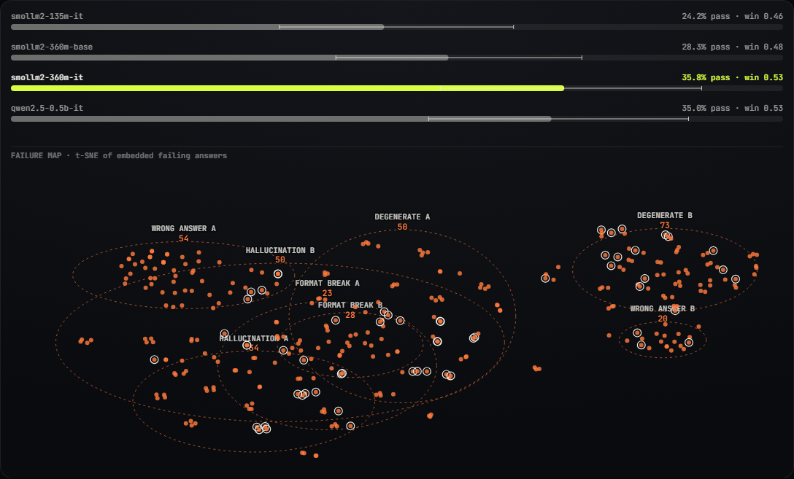
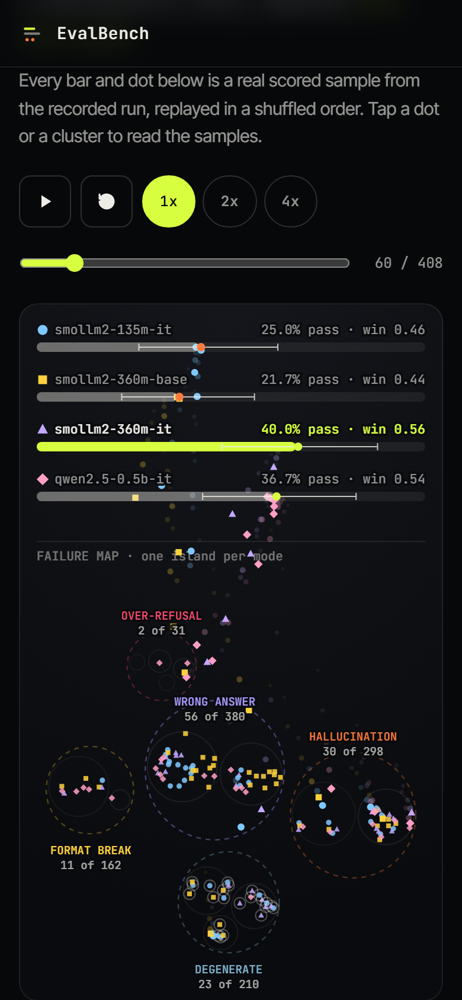
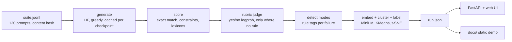

# EvalBench

An evaluation harness that finds where a model fails, not just how often.

It runs one prompt suite across several model checkpoints, scores every output (exact match and rule checks first, a small rubric judge only where no rule exists), then embeds the failing answers, clusters them, and labels the clusters with failure modes: hallucination, format break, over-refusal, wrong answer, degenerate output. The point is to make the next fine-tuning cycle target something specific. I work on post-training and evaluation, and "pass rate went from 28% to 36%" never told me what to fix next.

The `docs/` folder is a static site that replays a real recorded run (serve it with any static file server, see below). It is a recording, not a live model.





## What the run found

Everything below comes from one run of this repo on a CPU desktop (all generation, both judges and the embeddings ran on the CPU in float32, so every checkpoint and both judges share one device and dtype): 120 prompts, 4 checkpoints, judge Qwen2.5-0.5B-Instruct. It is a small demo, not a benchmark. With 120 prompts the 95% intervals are roughly plus or minus 9 points, so most gaps between checkpoints are noise.

Pass counts by task (a pass is a rule pass, or the judge saying "no misconception" on the truth items):

| checkpoint | math | knowledge | format | truth | unanswerable | benign | all (95% Wilson CI) |
|---|---|---|---|---|---|---|---|
| smollm2-135m-it | 0/24 | 4/24 | 7/24 | 2/16 | 1/16 | 15/16 | 29/120, 24.2% [17.4, 32.6] |
| smollm2-360m-base | 3/24 | 9/24 | 3/24 | 3/16 | 0/16 | 16/16 | 34/120, 28.3% [21.0, 37.0] |
| smollm2-360m-it | 2/24 | 7/24 | 15/24 | 5/16 | 0/16 | 14/16 | 43/120, 35.8% [27.8, 44.7] |
| qwen2.5-0.5b-it | 2/24 | 12/24 | 10/24 | 1/16 | 5/16 | 12/16 | 42/120, 35.0% [27.1, 43.9] |

Win-rate against the other three (per prompt, higher score wins, ties count half, bootstrap 95% CI): 360m-it 0.533 [0.497, 0.569], qwen 0.528 [0.487, 0.565], 360m-base 0.483 [0.446, 0.518], 135m-it 0.456 [0.425, 0.485]. The top two are indistinguishable.

### What post-training changed (SmolLM2-360M base to Instruct)

Same architecture, same 120 prompts, counted per sample: 20 prompts fixed, 11 regressed, 66 still failing (`evalbench diff`).

| failure mode | base | instruct | change |
|---|---|---|---|
| hallucination | 22 | 20 | -2 |
| format break | 19 | 8 | -11 |
| wrong answer | 34 | 22 | -12 |
| over-refusal | 0 | 2 | +2 |
| degenerate | 11 | 25 | +14 |

Instruction tuning removed most format breaks (the format task went from 3/24 to 15/24). It did not fix hallucination on made-up entities (0/16 for both), and degenerate output grew. "Degenerate" means empty, looping, or still going when the token cap hit (160 tokens for math), and 23 of the instruct model's 25 are cap hits: it writes longer step-by-step answers than the base model and often does not reach the final line. That is partly a property of my token cap, so read it as "verbose under a cap", not "worse reasoning". Knowledge accuracy went down slightly (9/24 to 7/24); with n=24 that is within noise.

### Failure clusters (reported, not tuned)

332 failing samples, k=8 chosen by silhouette, MiniLM embeddings plus four structural features, KMeans, t-SNE for the layout.

- Overall purity against the rule-based failure tags: **0.825**. 58 of 332 samples carry a tag that disagrees with their cluster's label. They are drawn with a ring in the UI and listed in the drawer.
- Silhouette is only **0.091**: the clusters overlap heavily in the 2D view. Adjusted mutual information of the clusters with the failure tag is 0.518, with the *task* it is 0.608. So the embedding groups by what the prompt was about at least as much as by how the model failed, and I did not tune it to hide that.
- Cleanest: WRONG ANSWER A (n=54, purity 0.93). Muddiest: FORMAT BREAK A (n=23, purity 0.70, with 5 hallucinations mixed in) and HALLUCINATION A (n=34, 0.77, with 7 format breaks).
- Labels are the plurality of the rule-based tags in each cluster, not a model's opinion. Two clusters can share a mode (A and B).

### How reliable is the judge?

I compared two local judges on the recorded generations against the labels I can trust (exact match on math and knowledge, 192 samples), plus the phrase-lexicon labels and a pairwise check:

| judge | accuracy vs exact match | Cohen's kappa | lexicon agreement (n=128) | pairwise accuracy, swap-averaged (n=60) | pairwise flip rate |
|---|---|---|---|---|---|
| Qwen2.5-0.5B-Instruct | 83.3% | **0.49** | 86%, kappa 0.72 | 50% | 58% |
| Qwen2.5-1.5B-Instruct | 57.3% | 0.26 | 92%, kappa 0.84 | 75% | 65% |

The rule I fixed before looking was: the default judge is the one with the higher kappa against exact-match labels, so the 0.5B model is the default. The 1.5B judge is lenient on reference-answer questions (it says "yes" for 63% of samples when 20% are correct) but better on the other two measures, so this is a mixed result, not a clear win. Both judges are weak, and the pairwise check flips its answer in more than half the cases when the two responses are swapped. That is why the design is rule-first: the judge decides only the 16 open-ended truthfulness items per checkpoint, and the 0.5B judge is also one of the four checkpoints, so its verdicts on its own answers are biased. Treat the truth column as the least reliable one. (Note the judge is validated on a different question type than the one it decides, since the truth items have no exact-match gold.)

Speed, seconds per prompt on CPU while other jobs were running (so not clean benchmarks): 135M 4.6 s, 360M base 5.8 s, 360M instruct 9.6 s, Qwen 10.7 s. Total generation time about 61 minutes. Judging 480 generations took 24 minutes (0.5B) and 49 minutes (1.5B).

## Architecture



- `src/evalbench/suite`: builds the suite from GSM8K, MMLU, IFEval, TruthfulQA, XSTest plus items I wrote (fake-entity questions, JSON tasks). Fixed seed, content hash.
- `src/evalbench/models.py`: batched greedy generation on CPU. Base models get a plain prompt and stop at the next "Question:". Output is appended per checkpoint to `runs/<id>/generations/`, so a stopped run resumes.
- `src/evalbench/scorers`: extractors, constraint verifiers, refusal and abstention lexicons, and the judge interface with `local:`, `openai:` and `anthropic:` backends.
- `src/evalbench/failures/cluster.py`: clustering, labels, purity, the list of disagreeing samples.
- `src/evalbench/report.py`: pandas reports (Wilson intervals, win-rate matrix, mode table, diff, judge statistics, fine-tuning targets).
- `src/evalbench/api.py`: FastAPI (`/health`, `/api/runs`, `/api/runs/{id}`, samples, and `/api/try` to run a custom prompt on local checkpoints).
- `web/`: vanilla JS and canvas. The race and the failure map replay the real per-sample verdicts in a shuffled order; nothing is simulated. Tap a dot or cluster for a drawer (a bottom sheet on phones) with the prompt, gold answer, output and evidence.

## Quickstart

```bash
python -m venv .venv && source .venv/bin/activate      # Windows: .venv\Scripts\activate
pip install -e ".[dev]"                                # needs torch; the CPU build is fine
pytest && ruff check .                                 # 33 fast tests, offline
evalbench serve                                        # http://127.0.0.1:8101, shows the committed run in runs/main
# or, without a backend:
python -m http.server 8101 --directory docs
```

The committed run needs no models. To redo the run (about 3 GB of model downloads, a couple of hours on CPU, resumable): `bash scripts/reproduce.sh`. It builds the suite, generates, compares the judges, writes `runs/main/run.json` and exports `docs/`. Screenshots come from `python scripts/shots.py` (headless Chromium at 1440x900 and 390x844).

Other commands: `evalbench report --run runs/main`, `evalbench diff --run runs/main smollm2-360m-base smollm2-360m-it`, and `evalbench targets --run runs/main` (ranked failure modes as JSONL for the next fine-tuning data request).

## What was run for real, and what was not

- Run for real: the four local checkpoints, both local judges, clustering, the API and the UI (headless Chromium at desktop and phone sizes, no console errors, no horizontal scroll at 390 px, tap targets at least 44 px, in served mode and as static `docs/`).
- Adapter code only: the OpenAI and Anthropic judges (`EVALBENCH_JUDGE=openai:<model>` or `anthropic:<model>`) are tested against stubbed HTTP transports. I never called either API. The Anthropic API returns no token probabilities, so that adapter gives hard 0 or 1 judgements.

## Design decisions

- Rules first, judge second. A small model grading maths is not a measurement; exact match is.
- The judge reads the probability of "Yes" against "No" instead of parsing free text, and is checked against the rule labels, with the numbers shown above.
- Cluster labels come from rule tags, and purity and the disagreeing samples are published rather than tuned away.
- Greedy decoding and a content-hashed suite, so a run is reproducible and two runs can be diffed.

## Limitations

- 120 prompts and models under 1B parameters. Differences of a few points are noise, and the intervals say so.
- The token cap (96 to 224 depending on the item) penalises verbose models, and "degenerate" mixes truncation with real looping. A truncated answer to a made-up-entity question is counted as degenerate, not hallucination, because truncation is checked first.
- The failure-map clusters overlap (silhouette 0.09) and partly follow the task rather than the failure mode.
- The "unanswerable" and "benign" checks use phrase lexicons, which can miss unusual wording.
- The judge comparison is one run on 192 labelled samples and 60 pairs.
- Timings come from a busy machine.

## Related tools

EvalBench is a small experiment next to mature projects: [lm-evaluation-harness](https://github.com/EleutherAI/lm-evaluation-harness), [Inspect](https://github.com/UKGovernmentBEIS/inspect_ai), [promptfoo](https://github.com/promptfoo/promptfoo), [OpenAI evals](https://github.com/openai/evals), [DeepEval](https://github.com/confident-ai/deepeval) and [HELM](https://crfm.stanford.edu/helm/). I borrowed ideas from them (declarative tasks, per-case assertions, per-sample logs); my notes are in `docs/notes/RESEARCH.md` and the design in `docs/notes/SPEC.md`. For broad benchmark coverage use those. What I wanted here was clustering of failures into labelled modes on a laptop-sized suite.

## Credits and licences

Code: MIT, Aditya Jain. Models (all Apache-2.0): SmolLM2 by Hugging Face, Qwen2.5 by Alibaba, all-MiniLM-L6-v2 by sentence-transformers. Data: GSM8K (MIT), MMLU (MIT), IFEval (Apache-2.0), TruthfulQA (Apache-2.0), XSTest (CC-BY-4.0), plus items I wrote. No model weights are committed.

Built by [Aditya Jain](https://adityajain16.vercel.app). Repo: https://github.com/Aditya2616/EvalBench
